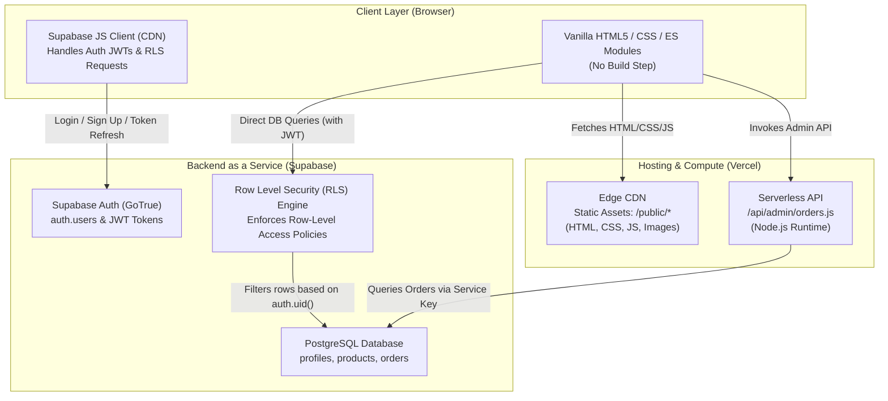
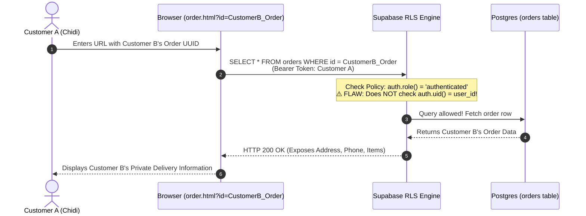
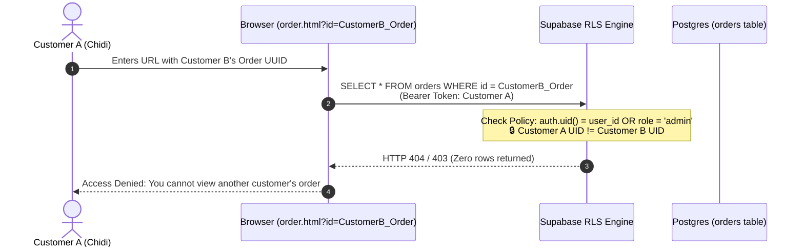
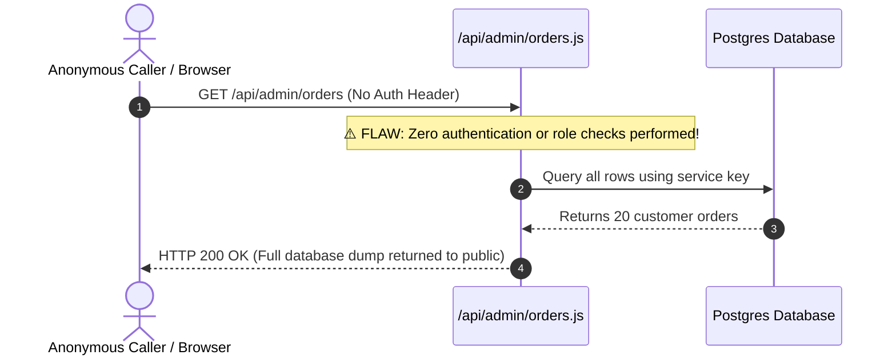
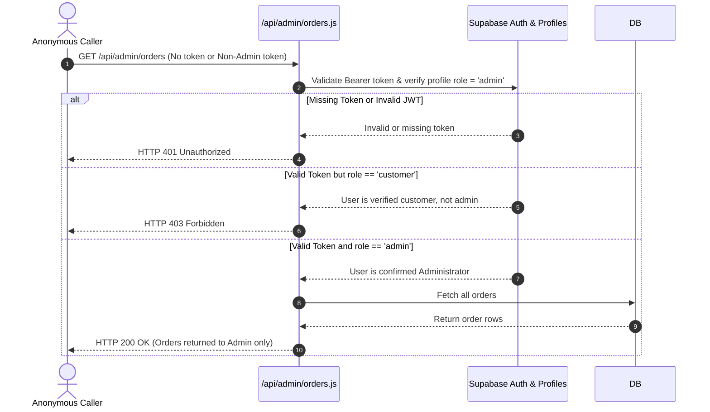

# ShopNaija Architecture Specification

This document details the defensive security architecture for **ShopNaija**, a purposefully vulnerable e-commerce training application built for TikTok LIVE cybersecurity sessions.

---

## 1. System Architecture



---

## 2. Request Flow: Viewing an Order (Vulnerable vs. Fixed)

### A. Vulnerable Request Flow (VULN-1 IDOR)
An attacker (authenticated as Customer A) changes the order ID parameter to request Customer B's order.



### B. Fixed Request Flow (Remediated Access Control)
The secure policy verifies that the authenticated user either owns the row or holds the `admin` role.



---

## 3. Request Flow: Admin Orders Endpoint (Vulnerable vs. Fixed)

### A. Vulnerable Admin Endpoint (VULN-3 Unprotected API)



### B. Fixed Admin Endpoint (Server-Side JWT & Role Verification)



---

## 4. Branch & Deployment Workflow

```mermaid
gitGraph
    commit id: "Initial Commit (Base Architecture)"
    branch vulnerable
    checkout vulnerable
    commit id: "Add VULN-1 (Permissive RLS in vulnerable.sql)"
    commit id: "Add VULN-2 (Exposed API Key in frontend)"
    commit id: "Add VULN-3 (Unprotected /api/admin/orders)"
    checkout master
    branch fixed
    checkout fixed
    merge vulnerable
    commit id: "FIX-1: Replace RLS policy (supabase/fixed.sql)"
    commit id: "FIX-2: Move secret key to Vercel backend env var"
    commit id: "FIX-3: Add JWT & Admin role verification to /api/admin/orders"
```

### Deployment Guidelines:
* **`vulnerable` branch**:
  - Run locally (`npx serve public` or `vercel dev`) OR
  - Deploy to Vercel with **Deployment Protection** (Password Protection enabled in Vercel Project Settings) so it is never publicly exposed on the open internet.
* **`fixed` branch**:
  - Can be deployed as standard production to show the remediated state.
